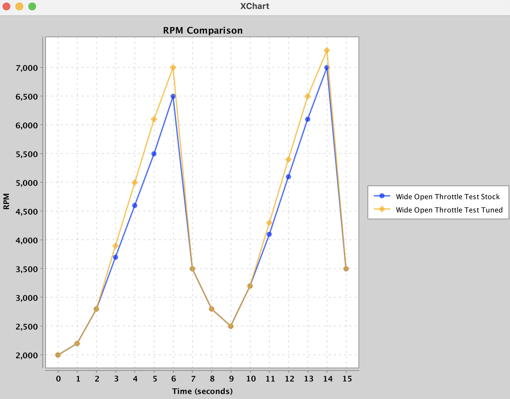
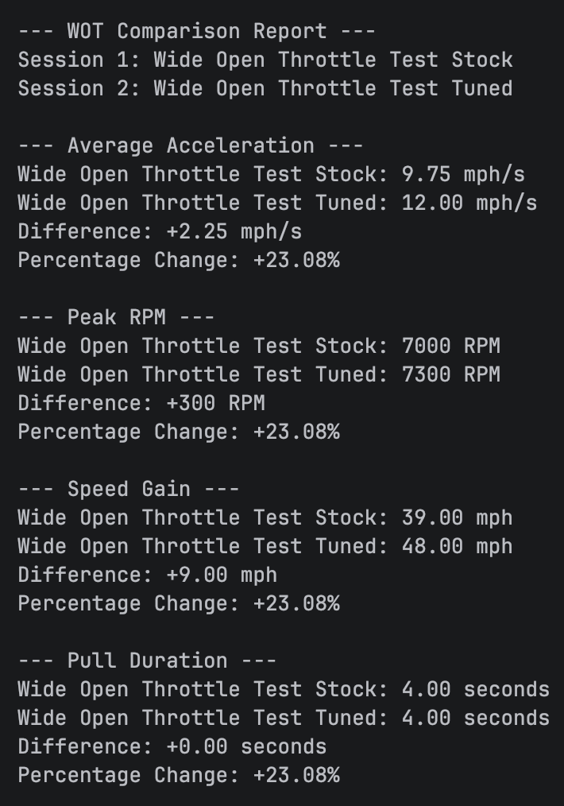
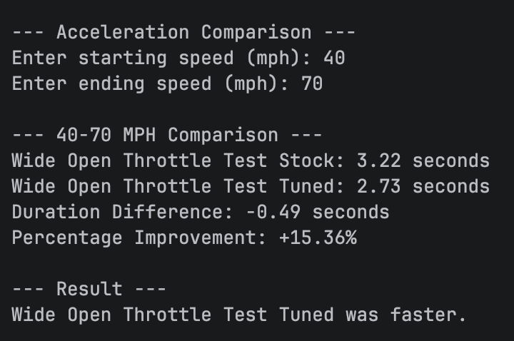

# Mustang Datalog Analyzer

A Java-based automotive datalog analysis application designed to evaluate vehicle performance, visualize sensor data, and compare performance before and after ECU tuning.

Built with a focus on automotive engineering, data analysis, and object-oriented software development.

## Overview

The Mustang Datalog Analyzer processes CSV-based vehicle datalogs and transforms raw sensor readings into meaningful performance insights. Users can analyze individual driving sessions or compare two sessions to evaluate changes in acceleration, RPM, throttle behavior, and engine temperature.

The application was developed as an independent software engineering project exploring the intersection of computer science and automotive powertrain calibration.

## Features

### Vehicle Data Analysis
- CSV datalog parsing and validation
- Peak and average RPM calculations
- Average vehicle speed and throttle analysis
- Maximum coolant temperature monitoring
- RPM distribution and high-RPM operation analysis

### Data Visualization
- Interactive RPM charts
- Coolant temperature charts
- Throttle position charts
- Side-by-side driving session comparisons
- PNG chart exports

### Performance Analysis
- Wide-open-throttle (WOT) pull detection
- Complete and incomplete pull classification
- Peak RPM and speed gain calculations
- Average acceleration and RPM gain per second
- Fastest and longest pull identification
- Custom speed-range acceleration timing using linear interpolation

### Before-and-After Tune Comparison
- Acceleration performance comparisons
- Peak RPM and speed gain differences
- Percentage-based performance changes
- Fastest acceleration run identification

### Data Reliability
- Malformed CSV row detection
- Sensor value range validation
- Duplicate and out-of-order timestamp rejection
- NaN and Infinity rejection
- Missing datalog reading estimation
- Irregular sampling interval detection
- Rejection of unreliable acceleration runs across large data gaps

## Screenshots

### RPM Comparison



### Wide-Open-Throttle Comparison



### Acceleration Comparison



## Technologies Used

| Technology | Purpose |
|---|---|
| Java 17 | Core application development |
| Maven | Dependency management and build automation |
| XChart | Data visualization and chart exports |
| JUnit 5 | Automated unit testing |
| Maven Shade Plugin | Executable JAR packaging |
| Git | Version control |

## Getting Started

### Requirements

- Java 17 or newer
- Maven 3.6.3 or newer for building from source
- A graphical desktop environment for displaying charts

### Build from Source

Clone the repository and navigate into the project directory.

```bash
git clone https://github.com/danielcalderoncodes/Mustang-Datalog-Analyzer.git
cd Mustang-Datalog-Analyzer
```

Build the application:

```bash
mvn clean package
```

This compiles the source code, runs the automated tests, and generates an executable JAR containing the required application dependencies.

### Run the Application

```bash
java -jar target/vehicle-data-analyzer-1.0-SNAPSHOT.jar
```

The application provides a terminal-based menu for analyzing individual datalogs and comparing two driving sessions.

## Example Usage

Select the option to compare two driving sessions.

Use the included example datalogs:

```text
data/examples/wot_test.csv
data/examples/wot_tuned_test.csv
```

From the comparison menu, users can generate sensor charts, compare WOT pulls, or calculate acceleration times across a custom speed range.

For example, entering a start speed of 40 mph and an end speed of 70 mph allows the application to calculate and compare 40–70 mph acceleration times.

### Example Performance Results

| Metric | Stock Example | Tuned Example |
|---|---:|---:|
| 40–70 mph time | 3.22 seconds | 2.73 seconds |
| Fastest WOT average acceleration | 9.75 mph/s | 12.00 mph/s |
| Peak RPM of fastest WOT pull | 7,000 RPM | 7,300 RPM |

These results are generated from synthetic example datalogs and are intended to demonstrate application functionality. They do not represent measured performance gains from an actual vehicle tune.

## CSV Data Format

The application expects five columns in the following order:

```csv
Time,RPM,Speed,Throttle,Coolant
0,2000,25,30,190
1,2800,35,95,191
2,3800,45,100,192
3,4800,55,100,193
```

| Column | Unit |
|---|---|
| Time | Seconds |
| RPM | Revolutions per minute |
| Speed | Miles per hour |
| Throttle | Percentage |
| Coolant | Degrees Fahrenheit |

Timestamps must be nonnegative and strictly increasing. Invalid readings are skipped and included in the data quality report.

## Project Structure

```text
Mustang-Datalog-Analyzer/
├── src/
│   ├── main/java/
│   └── test/java/
├── data/
│   ├── examples/
│   └── edge-cases/
├── screenshots/
├── pom.xml
├── README.md
└── .gitignore
```

## Software Architecture

The application separates data representation, analysis, visualization, and user interaction into dedicated classes.

| Class | Responsibility |
|---|---|
| Main | Application menus and user interaction |
| DataPoint | Individual vehicle sensor readings |
| Vehicle | Vehicle data storage and performance calculations |
| CsvReader | CSV parsing and data validation |
| CsvReadResult | Parsed vehicle data and reading statistics |
| RpmChart | Sensor visualization and chart exports |
| WotPull | Individual wide-open-throttle pull |
| WotPullAnalysis | WOT performance summaries |
| WotPullComparison | Performance differences between WOT pulls |
| AccelerationRun | Individual speed-range acceleration event |
| AccelerationRunAnalysis | Acceleration run analysis |
| AccelerationRunComparison | Acceleration performance comparisons |
| VehicleComparison | Vehicle session comparisons |
| InputHelper | User input validation |
| ReportFormatter | Consistent numerical report formatting |

## Automated Testing

The project includes 45 automated JUnit tests covering core calculations, data validation, performance comparisons, and reliability edge cases.

Test coverage includes:

- WOT pull duration, acceleration, and RPM calculations
- Complete and incomplete pull detection
- Rejection of single-reading throttle spikes
- Acceleration timing through linear interpolation
- Rejection of acceleration runs across large data gaps
- Before-and-after performance comparisons
- Exclusion of incomplete pulls from performance summaries
- Malformed CSV rows and invalid sensor values
- Duplicate and out-of-order timestamps
- Missing CSV files
- NaN and Infinity rejection

Run the complete test suite:

```bash
mvn test
```

## Current Limitations

- The application currently uses a predefined five-column CSV format.
- Performance calculations are based on logged sensor readings and sampling frequency.
- Acceleration timing uses linear interpolation between readings.
- WOT detection uses a configurable-in-code threshold of 90% throttle.
- Performance comparisons do not currently normalize for gear, road grade, vehicle weight, weather, or traction conditions.

## Future Development

- Support additional automotive datalog formats
- Air-fuel ratio and lambda analysis
- Ignition timing and knock retard analysis
- Fuel trim and fuel system monitoring
- Gear-specific performance comparisons
- Expanded data quality reporting
- Graphical user interface
- Automated builds and testing through GitHub Actions

## Author

Daniel Calderon

Computer Science student at the University of Mary Washington with interests in automotive software, ECU calibration, powertrain engineering, and performance data analysis.

Developed as an independent portfolio project combining software engineering with automotive performance.
